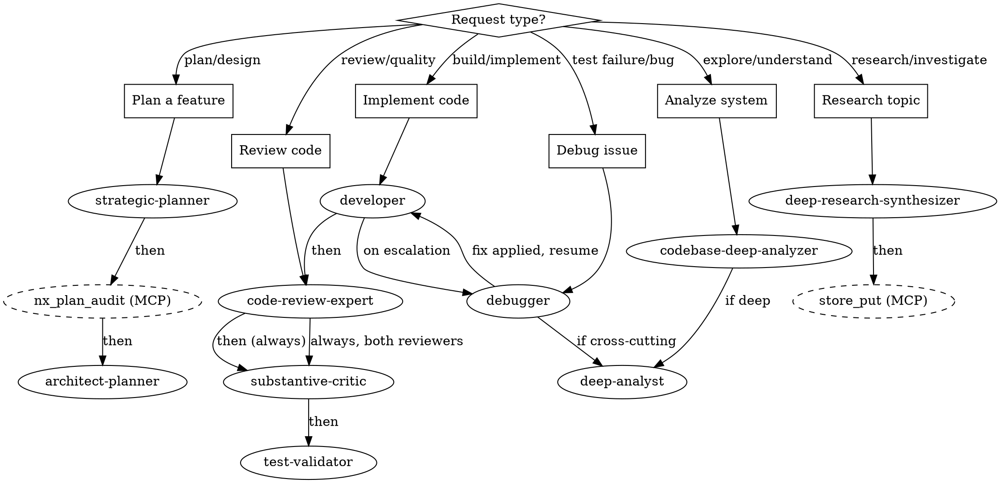

# Orchestration Reference

Routing tables, pipeline templates, and decision framework for multi-agent workflows. This is a reference document, no agent is dispatched.

## Routing Graph

## Routing Quick Reference

| Request Type | Primary Agent | Pipeline |
|-------------|---------------|----------|
| Plan a feature | strategic-planner | -> nx_plan_audit (MCP) -> architect-planner |
| Implement code | developer | -> code-review-expert -> substantive-critic -> test-validator |
| Implement code (circuit breaker fired) | debugger | [after developer stops] -> debugger -> developer resumes |
| Debug issue | debugger | -> (if cross-cutting) deep-analyst |
| Review code | code-review-expert | -> substantive-critic (always, both reviewers) |
| Research topic | deep-research-synthesizer | -> store_put (MCP direct) |
| Analyze system | codebase-deep-analyzer | -> (if deep) deep-analyst |

## Decision Framework

### Step 1: Classify the Request
- **Implementation**: Code needs to be written -> developer
- **Architecture/Design**: System design needed -> architect-planner or strategic-planner
- **Bug/Issue**: Something is broken -> debugger
- **Review**: Work needs validation -> code-review-expert, `mcp__plugin_conexus_nexus__nx_plan_audit` (for plans), or substantive-critic
- **Catalog Query**: Question about specific authors, papers, citations, provenance, references, corpus -> `nx_answer` (catalog-aware retrieval; see § nx_answer below)
- **Research**: General information gathering -> deep-research-synthesizer
- **Analysis**: Understanding needed -> deep-analyst or codebase-deep-analyzer

### Step 2: Check for Pipeline Needs
If the task requires multiple stages:
1. Identify all required agents
2. Determine the correct sequence
3. Define relay points and context requirements
4. Consider parallelization opportunities

### Step 3: Route or Dispatch
- **Single Agent**: Dispatch directly with context via relay
- **Pipeline**: Dispatch sequentially, the caller orchestrates each stage

## Standard Pipelines

### Feature Development Pipeline
1. strategic-planner: Create plan with beads
2. `mcp__plugin_conexus_nexus__nx_plan_audit`: Validate plan (RDR-080, no agent spawn)
3. architect-planner: Design architecture
4. developer: Implement with TDD
5. code-review-expert: Review implementation (line-level bugs, security, edge cases)
6. substantive-critic: Critique implementation (assumptions, scope reduction, vacuous assertions, spec drift). Both reviewers run; a clean code review does not permit skipping the critic.
7. test-validator: Verify test coverage

### Bug Fix Pipeline
1. debugger: Investigate and identify root cause
2. developer: Implement fix
3. code-review-expert: Review fix
4. substantive-critic: Critique fix (both reviewers run)
5. test-validator: Verify fix and regression tests

### Catalog Query Pipeline
Call `mcp__plugin_conexus_nexus__nx_answer` directly (RDR-080; `question`, optional `scope`).
Route here when the question involves: specific authors, paper citations, "what cites X",
"what research informed Y", corpus-scoped retrieval, or document provenance chains.

### Research Pipeline
1. deep-research-synthesizer: Gather information
2. `mcp__plugin_conexus_nexus__nx_tidy`: Consolidate findings (RDR-080, no agent spawn needed)
3. (optional) architect-planner: Apply findings to design

### Plan Validation Pipeline
1. strategic-planner or architect-planner: Create plan
2. `mcp__plugin_conexus_nexus__nx_plan_audit`: Validate technical accuracy (RDR-080, no agent spawn needed)
3. substantive-critic: Critique for gaps and assumptions

## Pipeline Pattern Catalog

These patterns are stored in the T2 plan library and are returned by `plan_search` when matching queries are detected. Run `mcp__plugin_conexus_nexus__plan_search` for a matching template before dispatching a multi-agent pipeline.

| Pattern | Agents | When to Use | Prerequisites |
|---------|--------|-------------|---------------|
| RDR Chain | deep-research-synthesizer → `/conexus:rdr-gate` → `/conexus:rdr-accept` → strategic-planner → `nx_plan_audit` → developer → code-review-expert → substantive-critic → test-validator | Non-trivial features needing design documentation before coding | RDR created and populated with research findings |
| Plan-Audit-Implement | strategic-planner → `nx_plan_audit` → developer → code-review-expert → substantive-critic → test-validator | Standard feature development with clear requirements | Requirements defined, no RDR needed |
| Research-Synthesize | deep-research-synthesizer → `nx_tidy` | Gathering information on unfamiliar topics or comparing approaches | Topic identified |
| Code Review | code-review-expert → substantive-critic → test-validator | Post-implementation quality gate before merge or PR | Code changes committed |
| Debug | debugger → developer → code-review-expert → substantive-critic → test-validator | Test failures or non-deterministic behavior, especially after 2+ failed manual fix attempts | Reproducible failure or clear symptom |

## Agent Ecosystem

### Development Agents
| Agent | When to Use |
|-------|-------------|
| developer | Execute implementation plans, write code with TDD |
| architect-planner | Design architecture, create execution plans |
| debugger | Complex bugs, non-deterministic failures, performance issues |
| (none, call `nx_answer`) | Analytical operations are handled by `nx_answer` internally (RDR-080) |

### Review Agents
| Agent | When to Use |
|-------|-------------|
| code-review-expert | Review implemented code for quality and best practices |
| `mcp__plugin_conexus_nexus__nx_plan_audit` | Validate plans before implementation (RDR-080, MCP tool, not agent) |
| substantive-critic | Deep critique of any content (code, docs, designs) |

### Analysis Agents
| Agent | When to Use |
|-------|-------------|
| deep-analyst | Investigate complex problems, system behavior analysis |
| codebase-deep-analyzer | Understand codebase structure, onboarding, pre-refactoring |

### Research Agents
| Agent | When to Use |
|-------|-------------|
| deep-research-synthesizer | Multi-source research across all knowledge bases |
| `nx_answer` (MCP tool) | Author, citation, corpus, or provenance questions, catalog-aware multi-step retrieval |

### Infrastructure Agents
| Agent | When to Use |
|-------|-------------|
| strategic-planner | Project planning, bead management, infrastructure setup |
| test-validator | Verify test coverage, run test suites |

## Skill Routing (what the SessionStart text points here for)

The six wrapper skills for the agents above are retired (nexus-dg7i6.6); dispatch the agent directly. These skills remain.

Before code:
- About to implement with no design of record: `/conexus:brainstorming-gate`. A locked T2 memo, accepted RDR or reviewed bead is the design of record: implement it without re-gating.
- Multi-step work: `/conexus:strategic-planning`. Cross-module design: strategic-planning, then `/conexus:architecture` (strategic-planner -> `nx_plan_audit` -> architect-planner).
- Plan ready: `/conexus:plan-validation`. Beads need execution context: `/conexus:enrich-plan`.

Understanding code: structure and dependencies `/conexus:codebase-analysis`; why it behaves as it does `/conexus:deep-analysis`; symbol navigation `/conexus:serena-code-nav`.

Quality: critique a design or implementation `/conexus:substantive-critique`; acting on review output `/conexus:receiving-review`; a change set against decision history `/conexus:decision-drift-review`.

Retrieval and knowledge:
- Reduced from many documents (cross-corpus synthesis, ranking or comparing, RDR research): `nx_answer`, or its verb skills `/conexus:analyze`, `/conexus:document`, `/conexus:design-to-code-trace`, `/conexus:why-was-this-written`. Broad research across store, web and code: `/conexus:research-synthesis`.
- 3+ validated findings to keep: `/conexus:knowledge-tidying`. PDF to index: `/conexus:pdf-process`. Entries, links, tumblers: `/conexus:catalog`.

RDR lifecycle: `/conexus:rdr-create` -> `/conexus:rdr-research` -> `/conexus:rdr-gate` -> (`/conexus:rdr-fix` per finding, re-gate) -> `/conexus:rdr-accept` -> implementation phases -> `/conexus:rdr-close`. List: run `nx rdr preamble rdr-list`. Show: `/conexus:rdr-show NNN`. Audit: `/conexus:rdr-audit`. Every phase-review bead runs `/conexus:phase-review-gate` before close: each numbered phase item in the RDR has a closing-bead pointer or an explicit `none` deferral. Nothing enforces it; it prevents silent scope reduction (RDR-112 Phase 1 dropped the T3 daemon from a 6-bead close, found three phases later, 2 to 3 days of replanning).

Git: isolation `/conexus:git-worktrees`; done `/conexus:finishing-branch`. Another session or agent: `/conexus:peer-messaging`, protocol `/conexus:mailbox`. Reference: `/conexus:nexus`, `/conexus:cli-controller`, `/conexus:writing-nx-skills`.

## nx_answer

For a question whose answer must be REDUCED FROM MANY DOCUMENTS: cross-corpus synthesis over `knowledge__` / `docs__` / `rdr__`, ranking or comparing across documents, RDR research where minutes are acceptable. It matches the plan library (threshold 0.40), runs the matched plan (or plans inline on a miss), and bundles contiguous operators into one `claude -p`.

Not for file:line answers (Serena or Grep), anything already in a local RDR, bead or T2 memory, or single-fact lookups: `search` / `query` answer in seconds (mean about 8s). Measured on 142 runs (2026-04 to 2026-08, T2 `nexus/nx-answer-capability-analysis-2026-08-19`): p50 80s, p95 217s, max 371s; 35% miss the plan gate and pay about 53s more for the inline planner; a call can hit its 300s timeout and return nothing. Budget minutes. Do not call `plan_match` yourself: you lose run recording and the fallback on miss. `mcp__plugin_conexus_nexus__plan_save` only a genuinely reusable retrieval plan, with a `verb`; implementation and phased-execution plans live in beads and T2.

## Working Rules

- **Sequential thinking** (`mcp__plugin_conexus_sequential-thinking__sequentialthinking`) before every decision, not only "non-trivial" ones (that qualifier measured to zero top-level calls in a full session, 2026-08-19). Decisions include what to dispatch, which fix, how to read a reviewer's verdict or a measurement, whether to push. Hypothesis, evidence, evaluate, branch or proceed; `isRevision` to correct, `branchFromThought` to explore. The thought is the record reviewers and siblings can see; internal reasoning is not.
- **Storage tiers**, read widest to narrowest before work: T3 `search` (all sessions and projects; check before researching), T2 `memory_search` (project decisions), T1 `scratch` (siblings this session). Write path: T1, then `--persist` to T2, then T3 via `store_put` after `/conexus:knowledge-tidying`. Findings not stored are findings lost: `store_put` or `memory_put` before returning a result a future session would want.
- **T2 ttl** (nexus-473mx, 2026-09-12): omit `ttl` for a record of record (handoff, decision, directive, ship record, research finding); pass `ttl=N` days for session findings, review rounds and probes that should expire. `tags` name the bead or RDR the entry serves.
- **`store_put` collection** is a durable subject area a reader would browse (`distributed-systems`), reused before minted (`nx collection list`), never `knowledge`, `default`, `test`, a session or a source app. Rules: docs/collections.md.

## Common Mistakes

| Mistake | Correction |
|---|---|
| `search` for "tradeoffs across the X papers" or "compare X across projects" when you need them reduced | `nx_answer`; budget minutes |
| `nx_answer` for a file:line, single-fact or already-in-T2 question | `search` / `query` (seconds) or Serena |
| Researching from scratch without checking T3 | `search` first; prior sessions may have answered |
| Returning findings without storing them | `store_put` or `memory_put` before returning |
| `memory_put` with a `ttl` for a decision, handoff or directive | omit `ttl` |
| Test fails, try another fix | dispatch the `debugger` after the second failed fix |
| Implement undesigned work | `/conexus:brainstorming-gate` first, unless a design of record exists |
| Plan exists, start implementing | `/conexus:plan-validation` first |
| Symbol callers via grep | `/conexus:serena-code-nav` |
| Implement review feedback blindly | `/conexus:receiving-review` first |
| Manual worktree setup | `isolation: "worktree"` on the Agent tool, or `/conexus:git-worktrees` |

## Red Flags

Thoughts that mean STOP, because you are rationalizing past a tier check:

| Thought | Reality |
|---|---|
| "Let me explore the codebase first" | T3 `search` first; prior research may already cover it. |
| "I can just grep for it" | T2 `memory_search` first if it is a project decision; T3 if general. |
| "I'll just answer this quickly" | Fine when the answer is local and you can point at it. Reduced from many documents is `nx_answer`, and costs minutes. |
| "I know what that means" | Knowing the concept is not knowing this project's history with it. Check T2/T3. |
| "This finding isn't worth storing" | Findings not stored are findings lost. The next session redoes your work. |
| "I'll file a bead for that and move on" | Filing is deferral that reads as progress. A gap in the work in hand is closed in this session; file only what cannot finish here (blocked on the user, another instance, or evidence that does not exist yet), and a filed bead is the next thing worked. |
| "One more pass would tighten this" | Execute the plan to done. No new round on finished work, no hop to an adjacent item mid-plan. Rounds are bounded by `review-rounds.toml`. |
